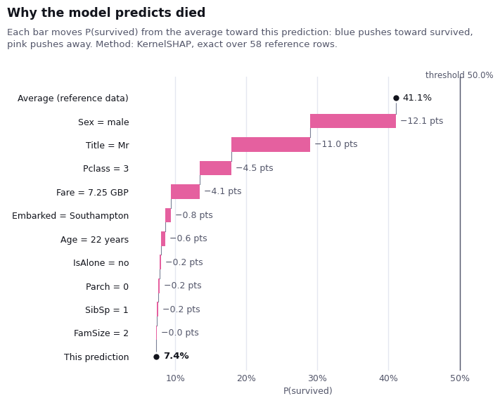
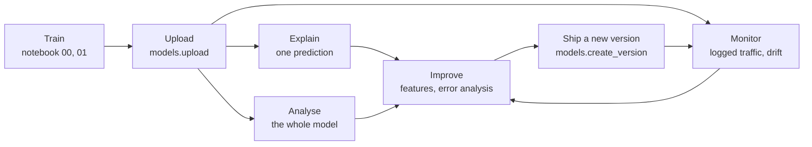
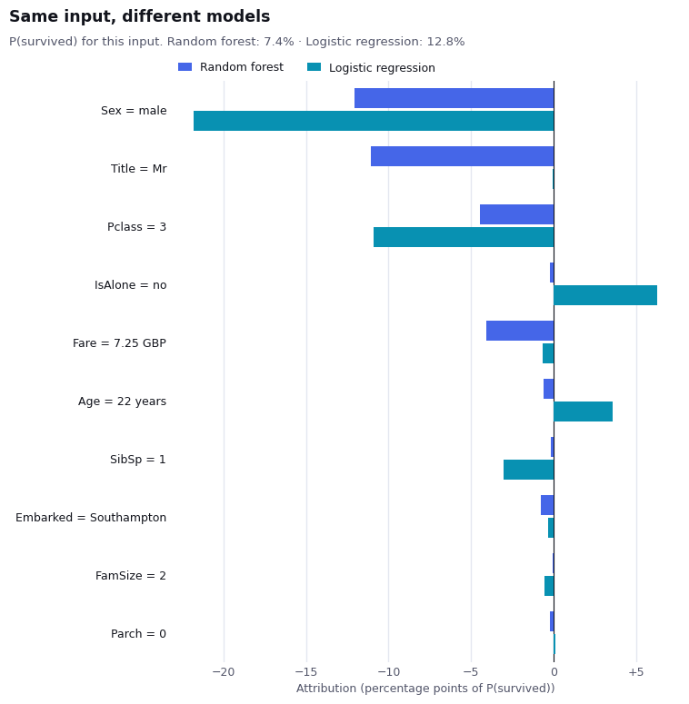
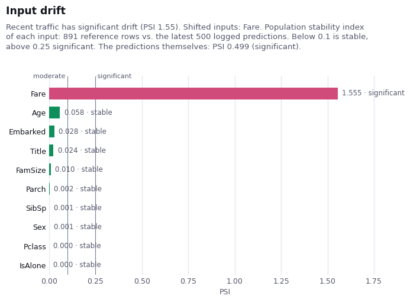
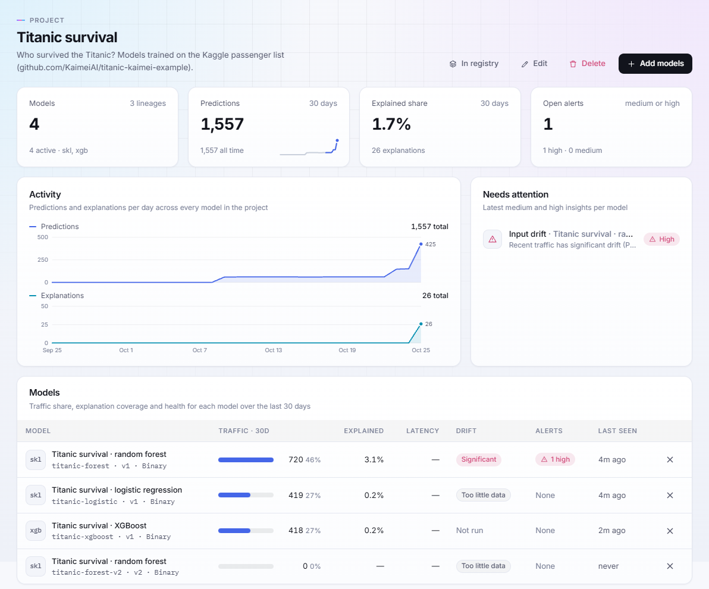
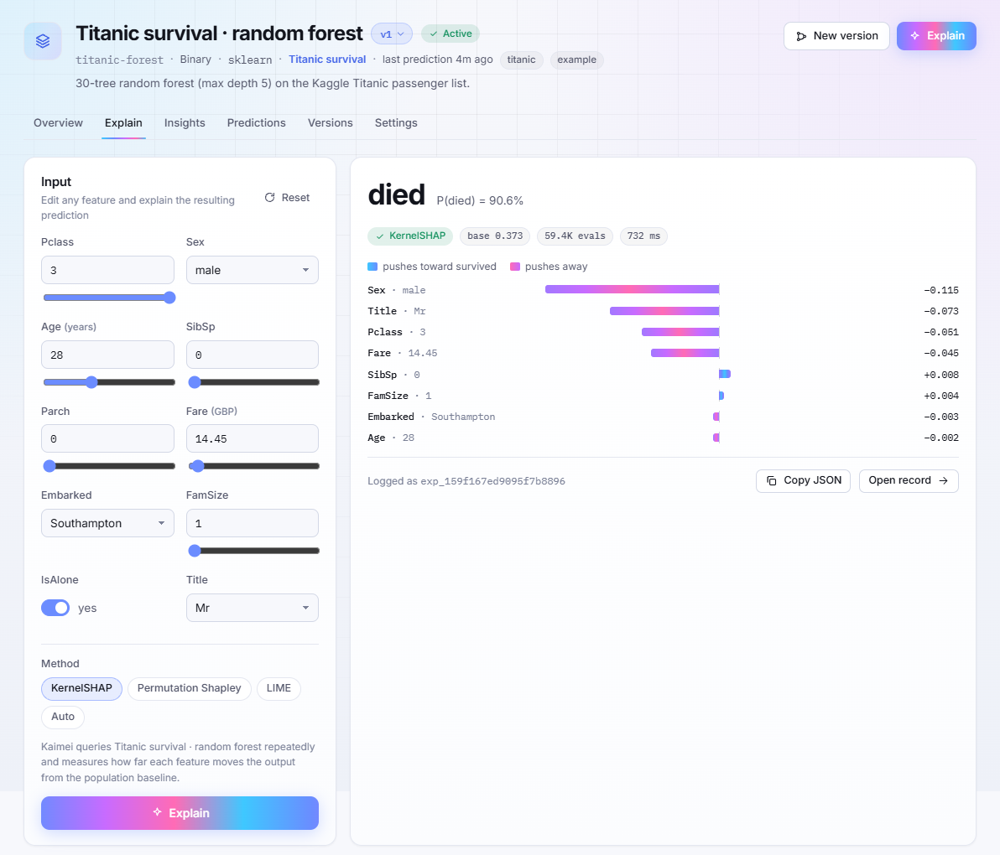
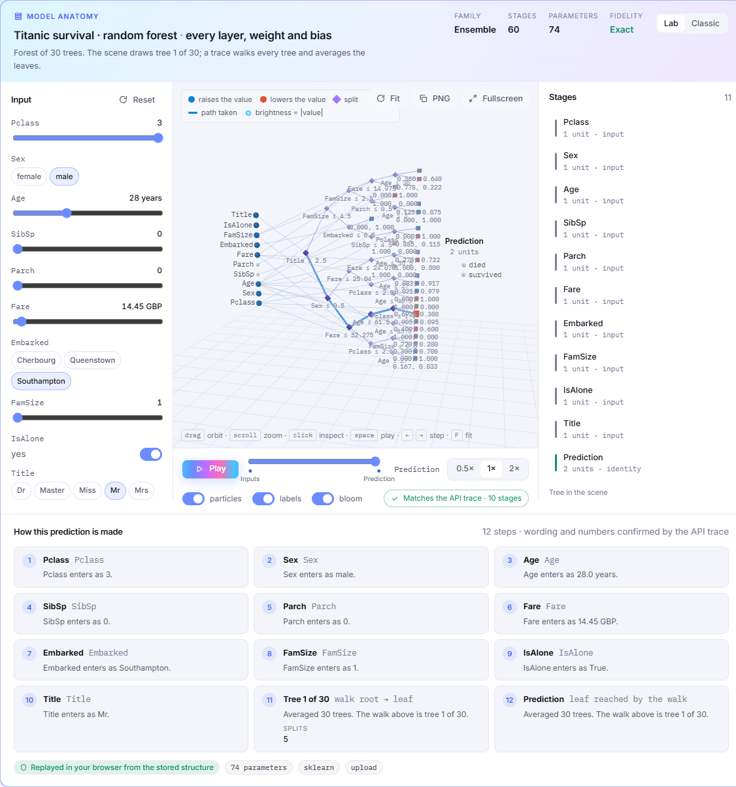

# Titanic × Kaimei

[](https://github.com/KaimeiAI/titanic-kaimei-example/actions/workflows/ci.yml)
[](https://pypi.org/project/kaimei/)
[](LICENSE)

A complete, runnable example of [Kaimei](https://kaimei.ai) in a machine-learning workflow, on a dataset everyone knows: who survived the Titanic?

Starting from a classic Kaggle notebook, this repository trains models, uploads them to Kaimei, and then:
- asks *why* they decide what they decide, passenger by passenger and across the whole model;
- monitors them on production traffic, and catches a data bug;
- improves the model, ships it as a new version, and compares the versions;
- covers models Kaimei can't run itself.

Everything happens from Python notebooks, and everything also appears on the Kaimei dashboard.



## The notebooks

Run them in order; each takes about a minute. Notebooks 01 to 04 need a free Kaimei account. Notebook 00 needs nothing.

| | Notebook | What you'll see | Kaimei features |
| --- | --- | --- | --- |
| 00 | [Titanic EDA and models](notebooks/00-titanic-eda-and-models.ipynb) | The starting point: data cleaning, feature engineering and eight classifiers compared by accuracy | none |
| 01 | [Explain a model](notebooks/01-explain-a-model.ipynb) [](https://colab.research.google.com/github/KaimeiAI/titanic-kaimei-example/blob/main/notebooks/01-explain-a-model.ipynb) | Why one passenger died; which ticket would have saved him; two models that disagree; what the forest learned overall | model upload, feature schema, SHAP explanations, counterfactuals, explanation methods, full analysis |
| 02 | [Monitor in production](notebooks/02-monitor-in-production.ipynb) [](https://colab.research.google.com/github/KaimeiAI/titanic-kaimei-example/blob/main/notebooks/02-monitor-in-production.ipynb) | Two weeks of traffic with a shadow model, then a feed that sends fares in pence, caught by drift detection | hosted predictions, logging predictions, shadow models, drift analysis, explaining a logged prediction |
| 03 | [Improve and version](notebooks/03-improve-and-version.ipynb) [](https://colab.research.google.com/github/KaimeiAI/titanic-kaimei-example/blob/main/notebooks/03-improve-and-version.ipynb) | Error analysis with explanations; better features; v2 shipped as a new version and compared with v1 | batch explanations, model versions, schema updates, comparing insights |
| 04 | [Bring your own model](notebooks/04-bring-your-own-model.ipynb) [](https://colab.research.google.com/github/KaimeiAI/titanic-kaimei-example/blob/main/notebooks/04-bring-your-own-model.ipynb) | XGBoost: explained with its own TreeSHAP values, and through a scoring endpoint Kaimei calls | pre-computed attributions, remote inference, private weights |

## Quick start

1. **Get an API key.** [Sign up for Kaimei](https://dashboard.kaimei.ai/signup) (the free plan is enough), then create a key under **API keys**.
2. **Install.** Python 3.9 or newer:

   ```bash
   git clone https://github.com/KaimeiAI/titanic-kaimei-example.git
   cd titanic-kaimei-example
   python -m venv .venv && source .venv/bin/activate   # Windows: .venv\Scripts\activate
   pip install -r requirements.txt
   ```

3. **Add your key.** Copy `.env.example` to `.env` and paste your key into it (`.env` is ignored by git). Or set `KAIMEI_API_KEY` in your environment; the notebooks ask for it if they find neither.
4. **Run.** `jupyter lab notebooks/` and open `01-explain-a-model.ipynb`.

No local setup? Each notebook has an *Open in Colab* badge above and a one-line install at its top.

### What it uses of a free plan

| Running | Models | Explanations | Analyses | Logged predictions |
| --- | --- | --- | --- | --- |
| 01 | 2 | 6 | 2 | 3 |
| 02 | — | 1 | 2 | 1,136 |
| 03 | +1 | 18 | 1 | — |
| 04 | +1 (+1 while the endpoint runs) | 2 | 0 (1 with an endpoint) | 419 |
| **All** | **4** (5 at most) | **27** | **5–6** | **~1,560** |

The free plan allows 10 models, 500 explanations, 20 analyses and 5,000 predictions a month. Re-running a notebook replaces the models it created, along with what they logged, so running everything again doesn't add to these totals.

## Where Kaimei fits in the workflow



## What the notebooks find

Things the accuracy column in notebook 00 never shows:

- **Two plausible models believe different things.** The forest and the logistic regression both say Mr Braund (third class, 22) died. The logistic regression says a first-class ticket alone would have saved him; the forest says no ticket would have. The reason: the logistic regression can't use the label-encoded `Title`, so it leans on class twice as hard. (01)

  

- **Kaimei surfaces a quirk of the data unprompted.** `Fare × FamSize` is one of the forest's strongest interactions, because a Kaggle fare is the price of the whole ticket, shared by the family. (01, fixed in 03)
- **A pipeline bug shows up as drift, and an explanation names the culprit.** When fares arrive in pence, drift on `Fare` turns significant within a batch. Explaining one affected prediction shows a third-class passenger's "£775 fare" as the biggest push toward survival. (02)

  

- **Error analysis says which fix you need.** The forest's mistakes are men who survived and women who died. Their explanations show it followed the strongest evidence it had, so these errors need new information, not a different model. (03)
- **v2 isn't more accurate, but its reasons hold up.** With fare per person, travelling-party size and a flag for missing ages, the forest scores the same, the fare interaction disappears, and a real effect appears: boys in large families rarely survived. (03)

And on the dashboard:

| Project overview | Explain any passenger | Walk the trees |
| --- | --- | --- |
|  |  |  |

## Using Kaimei with your own model

The notebooks are long because they show everything; the integration itself is short:

```python
from kaimei import Kaimei
from kaimei.tabular import explanation_summary, plot_explanation

client = Kaimei()  # KAIMEI_API_KEY from the environment

model = client.models.upload(
    fitted_model,                     # scikit-learn, Keras/TensorFlow, PyTorch, ...
    name="Churn v4",
    features=FEATURES,                # your feature schema (see src/titanic_kaimei/schema.py)
    X=X_reference, y=y_reference,     # reference rows explanations compare against
)
explanation = client.explanations.create(model=model.slug, input=row, method="shap")
print(explanation_summary(explanation))
plot_explanation(explanation)
```

- **Models Kaimei runs itself:** scikit-learn linear models, trees, forests of up to 30 trees, MLPs and scaler pipelines; Keras/TensorFlow and PyTorch networks.
- **Any other model:** register an HTTP scoring endpoint with `inference={"type": "remote", "url": ...}`, or send attributions you compute yourself (notebook 04).
- **Weights that must stay private:** `weights="summary"` uploads shapes only.

The [Python client documentation](https://github.com/KaimeiAI/kaimei-python-client#readme) covers each call, and every call is also plain REST (`https://api.kaimei.ai/v1/...`).

## Repository layout

```
├── notebooks/            00 → 04, committed with their outputs
├── src/titanic_kaimei/   the code the notebooks share
│   ├── data.py           load the Kaggle files; v1 and v2 features; encoding
│   ├── schema.py         Kaimei feature schemas
│   ├── models.py         the forest, logistic regression and XGBoost
│   ├── workspace.py      connect to Kaimei; idempotent uploads and analyses
│   └── serving.py        a FastAPI scoring service for Kaimei's remote inference
├── data/                 Kaggle's train.csv and test.csv (see data/README.md)
├── scripts/              run_notebooks.py: re-run the notebooks and save their outputs
├── tests/                offline tests; no Kaimei account needed
└── docs/images/          the pictures in this README
```

## Development

```bash
pip install -e ".[dev,notebooks]"
pytest                                  # offline: data, schema, model limits, scoring service, notebook hygiene
ruff check src tests scripts
python scripts/run_notebooks.py --all   # re-run every notebook against Kaimei and save the outputs
```

CI runs the offline tests on Python 3.9–3.13. The *Notebooks* workflow re-runs every notebook against Kaimei on demand; it needs a `KAIMEI_API_KEY` repository secret.

## Troubleshooting

- **`Set KAIMEI_API_KEY`**: no key found. Add it to `.env`, or set the environment variable before starting Jupyter.
- **`quota_exceeded`**: the free plan's monthly or model limit. Delete models you don't need on the dashboard, or wait for the next month.
- **`rate_limited` (HTTP 429)**: an hourly limit, for example 120 explanations an hour. Running the whole series uses 27; if you re-run it several times in a row, wait a while.
- **`Run notebook 01 first`**: notebooks 02–04 use the models 01 uploads.
- **Notebook 04 skips the endpoint**: Kaimei's servers can't reach `localhost`. Pick a port, expose it (for example `cloudflared tunnel --url http://127.0.0.1:8765`), and set `TITANIC_SCORING_PORT=8765` and `TITANIC_SCORING_URL` to the tunnel's public address before running the notebook.
- **A local Kaimei API**: set `KAIMEI_BASE_URL` (and `KAIMEI_DASHBOARD_URL` for the printed links).

## Credits and licence

The original analysis is Samson Qian's Kaggle notebook [*Titanic: Guide with sklearn and EDA*](https://www.kaggle.com/code/samsonqian/titanic-guide-with-sklearn-and-eda). The data is Kaggle's [Titanic competition](https://www.kaggle.com/competitions/titanic/data); see [data/README.md](data/README.md). The code is [MIT licensed](LICENSE).

Questions, problems or ideas: [open an issue](https://github.com/KaimeiAI/titanic-kaimei-example/issues).
